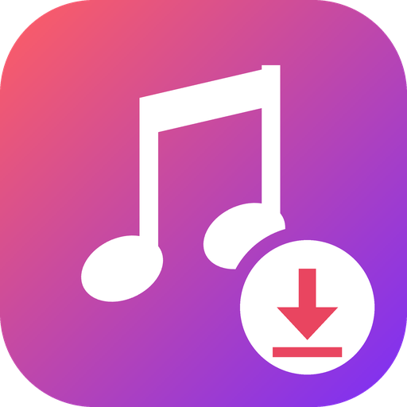
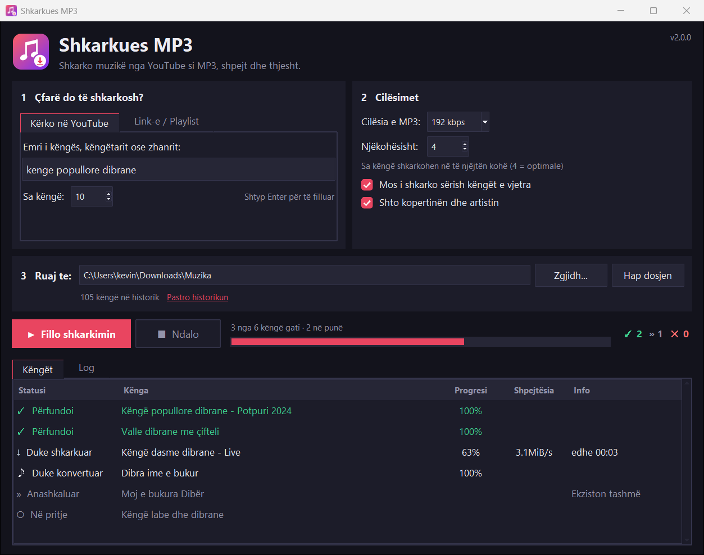

<p align="center">
  
</p>

<h1 align="center">Shkarkues MP3</h1>

<p align="center">
  Shkarko muzikë nga YouTube si MP3, shpejt dhe thjesht.<br>
  Kërko me emër ose ngjit link-e, dhe këngët ruhen në kompjuter me kopertinë dhe emër artisti.
</p>

<p align="center">
  
</p>

---

## Veçoritë

- **Kërko në YouTube**: shkruaj emrin e këngës, këngëtarit ose zhanrit dhe zgjidh sa këngë do.
- **Link-e dhe playlist**: ngjit një ose shumë link-e. Playlist-at hapen automatikisht në këngë të veçanta.
- **Shkarkime paralele**: deri në 8 këngë njëkohësisht (4 është optimale).
- **Cilësia**: 128, 192, 256 ose 320 kbps.
- **Kopertina dhe të dhënat**: MP3-ja merr fotografinë e videos, titullin dhe artistin.
- **Pa dublikata**: programi mban mend çfarë ke shkarkuar dhe nuk e shkarkon sërish.
- **Ndalo kur të duash**: butoni *Ndalo* i anulon këngët që s'kanë përfunduar.
- **Mban mend cilësimet**: dosja, cilësia dhe kërkimi i fundit ruhen për herën tjetër.

## Si ta përdorësh (për përdoruesit)

1. Hap **`ShkarkuesMP3.exe`**. Nuk ka nevojë për instalim, Python apo ffmpeg.
2. **Hapi 1**: zgjidh skedën *Kërko në YouTube* dhe shkruaj çfarë do, ose skedën *Link-e / Playlist* dhe ngjit link-et.
3. **Hapi 2**: zgjidh cilësinë (192 kbps mjafton për shumicën).
4. **Hapi 3**: zgjidh dosjen ku ruhen këngët. Si parazgjedhje është `Downloads\Muzika`.
5. Shtyp **▶ Fillo shkarkimin** (ose Enter te kërkimi).

Në tabelën *Këngët* shikon çdo këngë: progresin, shpejtësinë dhe kohën që mbetet.

- **Dy klikime** mbi një këngë të dështuar tregojnë arsyen.
- **Dy klikime** mbi një këngë të përfunduar hapin dosjen.

### Windows thotë "Windows protected your PC"?

Kjo ndodh sepse programi nuk është i nënshkruar dixhitalisht (nënshkrimi kushton para), jo sepse ka virus.
Kliko **More info → Run anyway**. Nëse antivirusi e bllokon, shtoje si përjashtim.

### Hapja e parë është e ngadaltë

`.exe`-ja shpaketon veten në sfond, kështu që hapja zgjat 5–10 sekonda. Kjo është normale.

## Zgjidhja e problemeve

| Problemi | Zgjidhja |
|---|---|
| Shumë këngë dështojnë me "Sign in to confirm…" ose "HTTP Error 403" | YouTube ka ndryshuar diçka. Duhet një version i ri i programit (shih *Ndërtimi* më poshtë). |
| "Video unavailable" | Video është fshirë, private ose e bllokuar në vendin tënd. |
| Një këngë nuk shkarkohet sërish | Është në historik. Hiq shenjën *Mos i shkarko sërish…* ose kliko *Pastro historikun*. |
| Shkarkimi është i ngadaltë | Ul numrin *Njëkohësisht* në 2–3 nëse interneti është i dobët. |

Historiku ruhet në `%USERPROFILE%\.music_downloader_history.json` dhe cilësimet në
`%USERPROFILE%\.music_downloader_settings.json`.

## Për zhvilluesit

### Nisja nga kodi

```powershell
uv venv
uv pip install -r requirements-dev.txt
.venv\Scripts\python.exe main.py
```

Kur e nis nga kodi, ffmpeg duhet të jetë në `PATH` (p.sh. `choco install ffmpeg`).

### Ndërtimi i `.exe`

```powershell
.\build.ps1
```

Skripti përditëson yt-dlp, rikrijon logon dhe ndërton `dist\ShkarkuesMP3.exe` (~95 MB, me ffmpeg brenda).
Nëse ffmpeg është diku tjetër: `.\build.ps1 -FfmpegDir "C:\ffmpeg\bin"`.

> YouTube ndryshon shpesh. Nëse shkarkimet fillojnë të dështojnë, mjafton të ekzekutosh
> `.\build.ps1` sërish dhe të dërgosh `.exe`-në e re.

### Struktura

```
main.py                 Pika e hyrjes
shkarkues/
  __init__.py           Emri dhe versioni
  config.py             Rrugët, ffmpeg, cilësimet (Settings)
  history.py            Historiku i shkarkimeve (thread-safe)
  downloader.py         Kërkimi dhe shkarkimi me yt-dlp (pa UI)
  ui.py                 Ndërfaqja Tkinter
assets/                 Logo dhe ikona (krijohen nga tools/make_logo.py)
tools/make_logo.py      Vizaton logon me Pillow
build.ps1               Ndërton .exe-në
docs/ZHVILLIMI.md       Si funksionon kodi nga brenda
```

Më shumë detaje te [docs/ZHVILLIMI.md](docs/ZHVILLIMI.md). Ndryshimet janë te [CHANGELOG.md](CHANGELOG.md).

## Shënim ligjor

Shkarko vetëm përmbajtje që ke të drejtë ta shkarkosh, p.sh. muzikë pa të drejta autori, me licencë të lirë,
ose për përdorim personal aty ku ligji e lejon. Kushtet e YouTube-it ndalojnë shkarkimin pa leje.
